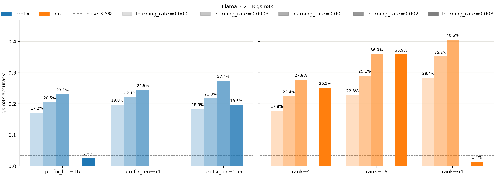
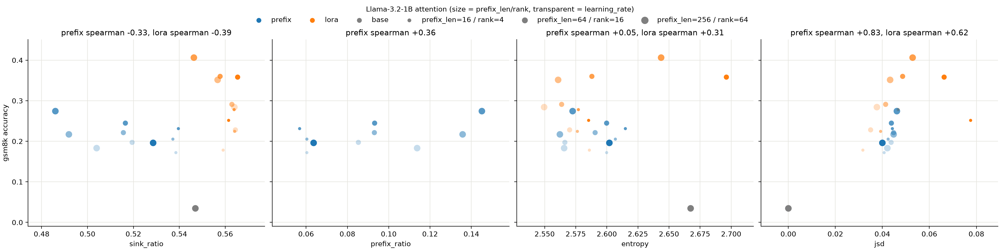

# vrank vs attention patterns

## 배경

[reasoncache](https://arxiv.org/abs/2602.02366)는 prefix tuning이 lora와 달리 value에 base가 쓰지 않던 새 방향을 더 많이 넣을 수 있어 표현력이 크다고 보이고, reasoning에서 lora를 넘거나 비슷하다고 주장.

다만 vrank가 실제로 정확도로 이어지는지는 확인하지 않았고, attention 패턴은 재지 않음. vrank가 높은 방법이 정확도도 높은지, 아니라면 attention 패턴이 정확도 차이를 설명하는지 확인함.

## 요약

- lora가 prefix tuning보다 정확도가 확연히 높아, reasoncache 결과는 재현되지 않음.
- prefix는 reasoncache 이론대로 value에 새 방향을 더함.
- vrank는 prefix tuning이 대체로 높지만 정확도는 낮아, 정확도 차이를 설명하지 못함.
- 입력 토큰에 새 방향을 더 많이 만드는 쪽은 오히려 lora임.
- 입력 토큰의 new_ratio는 방법 안과 방법 간 모두 정확도와 함께 움직임.
- attention 패턴도 정확도 차이를 설명하지 못함.
- prefix tuning에서는 prefix가 sink와 입력 토큰의 attention을 가져가, prefix-tuning+의 관찰과 같음.

## 한계

- 리소스 때문에 모델(llama 2 7b 대 llama 3.2 1b), 학습 데이터(metamathqa 전체 대 gsm 유형 32768개), learning rate(모든 방법 2e-5 대 1e-4~3e-3), 평가(lm-evaluation-harness 대 직접 채점)를 reasoncache와 다르게 골라, 재현 실험으로는 적절하지 않음.
- 이 차이들을 한꺼번에 바꿔, 재현 실패의 원인을 가르지 못함.
- seed 0 하나만 돌림.
- learning rate가 최적을 넘으면 hidden_rank와 jsd가 방법마다 다르게 움직여, 방법 안의 상관이 정확도를 따르는 것인지 학습량을 따르는 것인지 나누지 못함.

## 관련 연구

[reasoncache](https://arxiv.org/abs/2602.02366)는 lora가 value $XW_V$를 입력 $X$를 거쳐 바꾸므로 rank가 입력에 묶이는 반면(carrier bottleneck), prefix tuning은 입력을 거치지 않는 prefix value $P_V$로 새 방향을 더할 수 있다고 봄.

$$\text{lora: } \text{rank}(X(W_V + \Delta_V)) \le \text{rank}(X)$$

$$\text{prefix tuning: } \text{rank}(\text{concat}(P_V,\ XW_V)) \le \text{rank}(P_V) + \text{rank}(X)$$

실험에서는 gsm8k, math, gpqa 등에서 prefix tuning이 lora를 넘거나 비슷하고, 마지막 hidden의 effective rank도 prefix tuning이 가장 높다고 보고함.

lora가 prefix tuning보다 정확도가 높은 것은 [llm-adapters](https://arxiv.org/abs/2304.01933)에서도 보고됐고, prefix가 입력 토큰의 attention을 가져가는 것은 [prefix-tuning+](https://arxiv.org/abs/2506.13674)에서도 보고됨.

## prefix tuning이 lora보다 정확도가 높은지

### 실험 설정

모델은 reasoncache의 llama 2와 같은 계열인 llama 3.2 1b. 학습 데이터는 metamathqa의 gsm 유형 32768개. prefix tuning은 reasoncache를 따라 mlp 재파라미터화와 텍스트 초기화를 쓰되, few-shot 예시 대신 학습 데이터의 질문으로 초기화하고, prefix 길이는 16, 64, 256. lora는 q, k, v_proj에 붙이고 rank는 4, 16, 64.

둘 다 adamw weight decay 0, cosine 스케줄 warmup 0.05, batch 128, 3 epoch, 최대 2048 토큰이고, learning rate는 1e-4, 3e-4, 1e-3, 3e-3. prefix tuning은 3e-3에서 발산해 prefix 길이 16에서만 돌리고, prefix 길이 256에는 2e-3을 더 봄.

평가는 gsm8k test 1319개, zero-shot, greedy, 최대 512 토큰. 채점은 "The answer is" 뒤의 첫 숫자, 없으면 마지막 숫자를 정답과 비교.

### 결과

lora는 최대 40.6%로 prefix tuning의 최대 27.4%보다 높고(base 3.5%), 가장 작은 rank 4도 27.8%로 prefix tuning의 최대와 비슷함. lora도 rank 64 3e-3에서 발산함.

> reasoncache와 달리 lora가 prefix tuning보다 정확도가 높음.

## prefix tuning이 vrank를 키워 정확도를 높이는지

### 실험 설정

측정은 학습 데이터와 원본 질문이 겹치지 않는 gsm 유형 256개. vrank와 new_ratio는 sink와 prefix를 뺀 입력 토큰의 value로 봄. sink는 base와 lora에서는 bos이고, prefix tuning에서는 prefix 앞의 bos와 입력 bos를 합친 것.

vrank는 reasoncache를 따라 head별로 특이값 제곱의 누적 합이 90%를 채우는 방향 수이고, 마지막 layer만 봄. new_ratio는 base의 주요 방향 밖에 있는 성분의 norm 비율로 새 방향이 얼마나 생겼는지 봄. 둘 다 샘플별로 구해 평균 냄. prefix tuning은 prefix value의 new_ratio인 prefix_new_ratio도 봄.

hidden_rank는 lm_head 직전 hidden의 특이값을 샘플별로 정규화해 평균 낸 뒤 누적 합이 90%를 채우는 방향 수로, 새 방향이 마지막까지 이어지는지 봄. 상관은 방법 간 차이가 섞이지 않도록 방법 안에서 spearman으로 보고, 발산한 두 run은 뺌.

### 결과

입력 토큰의 vrank는 prefix tuning이 27.7~28.7로 base(27.5)와 lora(25.7~28.3)보다 대체로 높지만, 정확도는 lora보다 낮음. 방법 안에서는 정확도와 상관이 있음(prefix tuning +0.78, lora +0.85).

prefix_new_ratio는 0.63~0.73으로 reasoncache(0.7~0.9)보다 조금 낮지만, prefix가 새 방향을 더하는 것은 같음. 다만 같은 learning rate에서 prefix 길이를 16에서 256으로 키우면 정확도는 오르지만 prefix_new_ratio는 줄어, prefix의 새 방향은 정확도로 이어지지 않음.

입력 토큰의 new_ratio는 prefix tuning이 lora보다 낮고(0.41~0.43 대 0.42~0.52), 방법 안에서도 정확도와 상관이 큼(prefix tuning +0.92, lora +0.60).

hidden_rank는 reasoncache와 달리 prefix tuning이 lora보다 낮아(최대 145 대 147), prefix의 새 방향이 마지막 hidden까지 더 이어지지는 않음. 방법 안에서는 정확도와 상관이 있음(prefix tuning +0.84, lora +0.85).

> reasoncache 이론대로 prefix는 새 방향을 더하고 vrank도 대체로 높지만, 정확도는 오히려 입력 토큰에 새 방향을 더 많이 만드는 lora가 높음.

## attention 패턴이 정확도 차이를 설명하는지

### 실험 설정

앞과 같은 256개에서 layer와 head 전체의 평균으로 봄. entropy는 입력 토큰에 대한 attention을 다시 정규화해 구하고, jsd는 그 분포가 위치별로 base와 얼마나 다른지 봄. sink_ratio와 prefix_ratio는 각각 sink와 prefix로 가는 attention 비율.

### 결과

jsd만 방법 안에서 정확도와 상관이 뚜렷하고(prefix tuning +0.83, lora +0.62), entropy와 sink_ratio는 약함. 다만 jsd가 비슷한 0.04~0.05에서도 lora의 정확도가 더 높음.

prefix tuning은 sink_ratio가 줄고(0.547→0.49~0.54) prefix_ratio가 0.06~0.15로, prefix가 sink와 입력 토큰의 attention을 함께 가져감. prefix_ratio는 prefix가 길수록 대체로 커지고, lora의 sink_ratio는 base와 비슷함(0.55~0.57).

> attention 패턴도 정확도 차이를 설명하지 못함. prefix tuning에서는 prefix가 sink와 입력 토큰의 attention을 가져가지만, 왜인지는 확인하지 않음.
